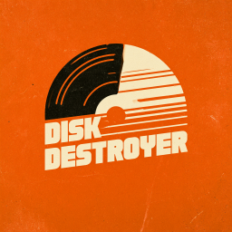

<div align="center">

  

  <br/>
  <br/>

  &nbsp;
  &nbsp;
  &nbsp;
  &nbsp;

</div>

***

<h6 align="center">

  [MANUAL](docs/man/README.md)&nbsp;&bull;&nbsp;[CHANGELOG](docs/CHANGELOG.md)&nbsp;&bull;&nbsp;[ROADMAP](docs/ROADMAP.md)&nbsp;&bull;&nbsp;[KNOWN ISSUES](docs/KNOWN-ISSUES.md)

</h6>

***

| CONTENTS                                      |
|-----------------------------------------------|
| [About Disk Destroyer](#about-disk-destroyer) |
| [How it works](#how-it-works)                 |
| [Getting started](#getting-started)           |
| [Installing](#installing)                     |
| [Usage](#usage)                               |
| [Acknowledgements](#acknowledgements)         |
| [Related projects](#related-projects)         |
| [License](#license)                           |

***

## About Disk Destroyer

**DiskDestroyer<sup>1</sup>** is a utility designed to fill up a disk drive data, overwriting any empty space.

## How it works

DiskDestroyer creates (or appends) random bytes to a file named `disk_destroyer.dat` on that drive

## Getting started

### Before you begin

⚠️ **Critical Safety Warnings:**

* This tool will **permanently destroy data** on the target drive
* The operation is **IRREVERSIBLE** — no recovery possible after execution
* May cause **system instability** if disk becomes too full
* Only run on drives you have explicit permission to modify
* **Backup important data** before running this tool

### Requirements

| Requirement | Minimum version | Notes |
|-------------|-----------------|-------|
| [.NET SDK](https://dotnet.microsoft.com/en-us/download/dotnet/10.0) | 10.0+ | Required to build and run |
| Windows OS | Any modern version | Tested on Windows platforms |
| Administrator privileges | Recommended | May be required for certain drives |

## Installing

### Prerequisites

Ensure you have the [.NET SDK](https://dotnet.microsoft.com/en-us/download/dotnet/10.0) installed and available in your PATH.

### Quick Start (Development)

```bash
# Clone or navigate to the repository
cd D:\Repositories\APCP\DiskDestroyer

# Restore dependencies
dotnet restore

# Build the project
dotnet build --configuration Release
```

## Usage

### Basic Usage

Run DiskDestroyer from a command prompt. The application will automatically use the current drive and default settings:

```bash
cd D:\Repositories\APCP\DiskDestroyer
dotnet run --project src/DiskDestroyer.csproj
```

The program will display a warning message and require confirmation before proceeding.

### Custom Chunk Size

Specify a custom chunk size in megabytes (e.g., `-8` for 8 MB chunks):

```bash
dotnet run --project src/DiskDestroyer.csproj -8
```

Available options:
* **No argument** — Uses default 1 MB chunk size
* **Positive number** — Sets chunk size in MB (e.g., `-4`, `-8`, `-64`)
* **Leading dash ignored** — You can use `--` prefix if needed

### Command Line Arguments

| Argument | Description | Default |
|----------|-------------|---------|
| `-N` or `--chunk-size=N` | Write chunk size in megabytes | 1 MB |

### Example Sessions

#### Filling C: Drive with Default Settings (1 MB chunks)

```bash
cd D:\Repositories\APCP\DiskDestroyer
dotnet run --project src/DiskDestroyer.csproj
```

**Expected output:**
```
Using chunk size: 1024 MB (1073741824 bytes)

WARNING: This will destroy data on drive C!

This action is IRREVERSIBLE and may cause system instability.

Are you absolutely sure you want to continue? (y/n)
Enter your choice: y

✓ Proceeding with write operation on C:\...
Writing to C:\disk_destroyer.dat
Progress: file=1,073,741 bytes, disk=XX.XX%
...
Reached target: 95.00% usage

=== Write Complete ===
Total bytes written: XXX,XXX,XXX (XX.XX GB)
Final disk usage: XX.XX%
Statistics recorded: X entries
```

#### Filling D: Drive with Larger Chunks (8 MB chunks)

```bash
dotnet run --project src/DiskDestroyer.csproj -8
```

## Documentation

* [Manual](docs/man/README.md) — Comprehensive user manual
* [API Reference](docs/api/README.md) — Complete API documentation
* [Development Guide](docs/DEVELOPMENT.md) — For contributors and developers
* [FAQ](docs/FAQ.md) — Frequently asked questions
* [Support](docs/SUPPORT.md) — Getting help and support options

## Acknowledgements

None.

## Built with

* [.NET 10+](https://dotnet.microsoft.com/) - Modern C# runtime and libraries
* [`System.IO`](https://learn.microsoft.com/en-us/dotnet/api/system.io) - File I/O operations
* [`DriveInfo`](https://learn.microsoft.com/en-us/dotnet/api/system.io.drivedriveinfo) - Disk space information

## Related projects

None.

## License

Copyright © 2026 [A Pretty Cool Program](https://github.com/aprettycoolprogram)  
Distributed under the [Apache 2.0 License](LICENSE)

***

<h6 align="center">

  [FAQ](docs/FAQ.md)&nbsp;&bull;&nbsp;[DEVELOPMENT](docs/DEVELOPMENT.md)&nbsp;&bull;&nbsp;[API](docs/api/README.md)&nbsp;&bull;&nbsp;[SUPPORT](docs/SUPPORT.md)&nbsp;&bull;&nbsp;[NOTICES](docs/NOTICES.md)

</h6>

<sup>**1**</sup> Disk Destroy *probably* won't *actually* destroy disks.
